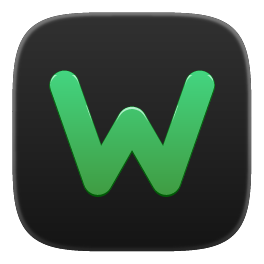
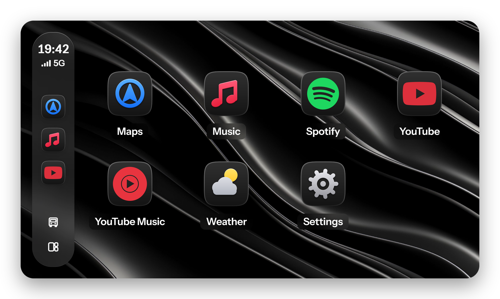
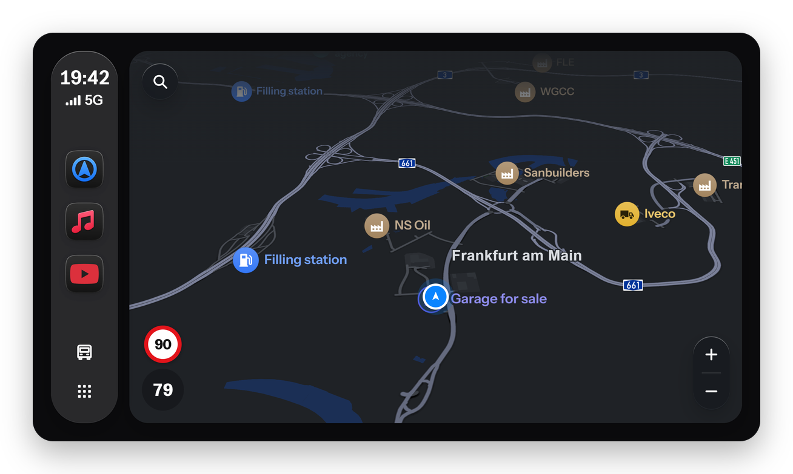
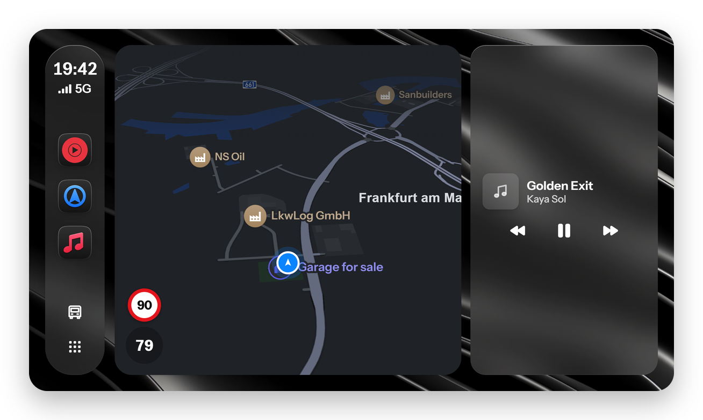
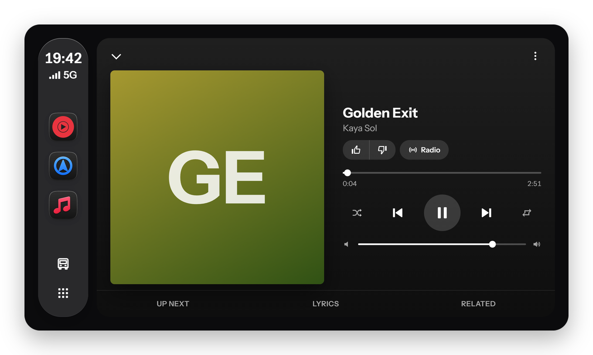
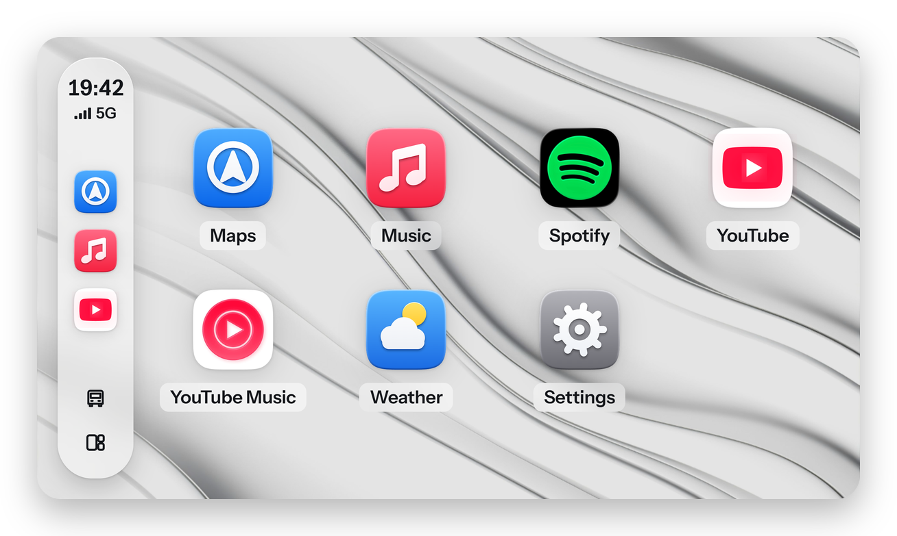
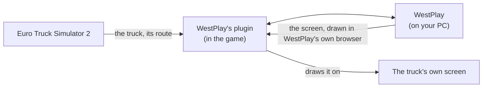

<p align="center"></p>

<h1 align="center">WestPlay</h1>

<p align="center">
  <b>A CarPlay-style screen for the trucks of Euro Truck Simulator 2.</b><br>
  Your map, your music and YouTube, on your truck's own dashboard screen.
</p>

<p align="center">
  <a href="https://github.com/enes-less/WestPlay/releases/latest"></a>
  
  
  <a href="LICENSE"></a>
</p>

<p align="center">
  <a href="#features">Features</a> ·
  <a href="#trucks">Trucks</a> ·
  <a href="#install">Install</a> ·
  <a href="#privacy">Privacy</a> ·
  <a href="#support">Support</a>
</p>

<br>

<picture>
  <source media="(prefers-color-scheme: dark)" srcset="docs/images/home-dark.png">
  <source media="(prefers-color-scheme: light)" srcset="docs/images/home-light.png">
  
</picture>

WestPlay puts a phone-style car screen on your truck's own dashboard display, inside the game. Your route on a
map made from your own game, your music, YouTube, the weather on your drive: right where a real truck has its
screen, used with the mouse while you hold a key.

## Features

<table>
  <tr>
    <td width="50%" valign="top">
      <picture>
        <source media="(prefers-color-scheme: dark)" srcset="docs/images/maps-dark.png">
        <source media="(prefers-color-scheme: light)" srcset="docs/images/maps-light.png">
        
      </picture>
      <h3>Maps from your own game</h3>
      Drawn from your game's map, map mods included (ProMods and others), with your route, turn-by-turn
      guidance, and search that adds stops to the game's own GPS.
    </td>
    <td width="50%" valign="top">
      <picture>
        <source media="(prefers-color-scheme: dark)" srcset="docs/images/dashboard-dark.png">
        <source media="(prefers-color-scheme: light)" srcset="docs/images/dashboard-light.png">
        
      </picture>
      <h3>A Dashboard for the drive</h3>
      The map beside what's playing and where you're going, the weather on your drive, all on one screen.
    </td>
  </tr>
  <tr>
    <td width="50%" valign="top">
      
      <h3>Your music</h3>
      Apple Music, Spotify and YouTube Music, with Now Playing and lyrics. A song's music video plays right in
      Now Playing, and YouTube has its channels, playlists, captions and quality.
    </td>
    <td width="50%" valign="top">
      <picture>
        <source media="(prefers-color-scheme: dark)" srcset="docs/images/looks-light.png">
        <source media="(prefers-color-scheme: light)" srcset="docs/images/looks-dark.png">
        
      </picture>
      <h3>Light and dark, and your own look</h3>
      It turns dark at night or when you switch your headlights on, like a car's light sensor. Bring your own
      wallpapers and app icons.
    </td>
  </tr>
</table>

**The companion app** on your PC sets everything up: it finds the game, installs WestPlay into it, builds your
map, and keeps WestPlay up to date.

## How it works



WestPlay draws its screen in a browser of its own on your PC, and its plugin puts each frame on your truck's
display, inside the game. The trucks' own screens and their information bars stay theirs: WestPlay takes the
GPS's place, and its Vehicle Bar setting says whether the truck's bar stays beside it.

## Trucks

WestPlay draws on the screens of the trucks that have CarPlay support in real life:

- **DAF** XF and XG/XG+ 2021 (and Jasper's DAF 2021)
- **Scania** S and R, with the 7" screen or the Smart Dash
- **Iveco** S-Way
- **Renault** T (2024)

A later release adds a tablet accessory, so WestPlay works in every truck and bus.

## Install

1. Download the installer from the [latest release](https://github.com/enes-less/WestPlay/releases/latest) and run it.
2. The companion opens and walks you through the rest: it finds your game, installs WestPlay's plugin and its
   screens mod, and builds your map.
3. Start the game and get in a truck.

WestPlay looks for updates on its own and asks before installing one.

**Requirements:** Windows 10 or 11 (64-bit), Euro Truck Simulator 2 version 1.61 (other versions may work; the
companion says when one is untested), and Microsoft Edge WebView2 (part of Windows 11; the installer adds it
where it's missing).

## Privacy

WestPlay has no servers, no accounts of its own and no analytics. It doesn't collect or send anything about you.

- You sign in to Apple Music, Spotify and YouTube on their own pages, in WestPlay's own browser profile on your PC,
  as you would in a browser. WestPlay keeps no account data of its own.
- Your map is built from your game on your PC and stays there.
- WestPlay talks to the services you use, to GitHub to look for updates, and to Kreosus only if you open
  "Support me".

## Support

WestPlay is free. If it makes your drives better, you can support its development:

<p>
  <a href="https://kreosus.com/enes-less"></a>
</p>

<details>
<summary><b>Building from source</b></summary>
<br>

You need [Rust](https://rustup.rs) (stable) and [Node.js](https://nodejs.org) 24, on Windows.

```sh
npm install      # the companion's tools and the UI's packages
npm run dev      # WestPlay, with the UI served live
```

`cargo test --workspace` and `npm test --prefix ui` run the tests. The game plugin is built with
`cargo build --release -p westplay-plugin`.

</details>

## Licence

WestPlay is free software: you can redistribute it and modify it under the terms of the GNU General Public
License, version 3 or (at your option) any later version. See [LICENSE](LICENSE).

The libraries WestPlay ships keep their own licences: see [THIRD_PARTY_LICENSES.md](THIRD_PARTY_LICENSES.md), and
[THIRD_PARTY_NOTICES.md](THIRD_PARTY_NOTICES.md) for the work it follows.

<sub>WestPlay is an independent project, not affiliated with or endorsed by Apple, SCS Software, Spotify, Google or
the truck makers. CarPlay, Apple Music, Spotify, YouTube, YouTube Music and the truck makers' names and logos are
trademarks of their owners, used to name what WestPlay works with. The screenshots show WestPlay's preview with
made-up songs.</sub>
